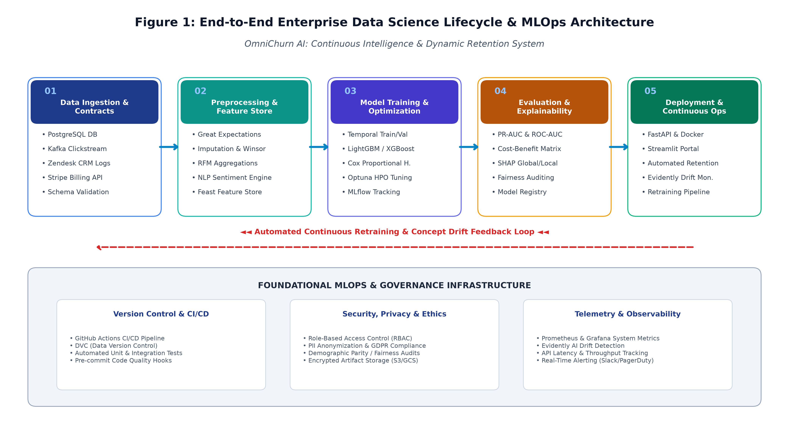
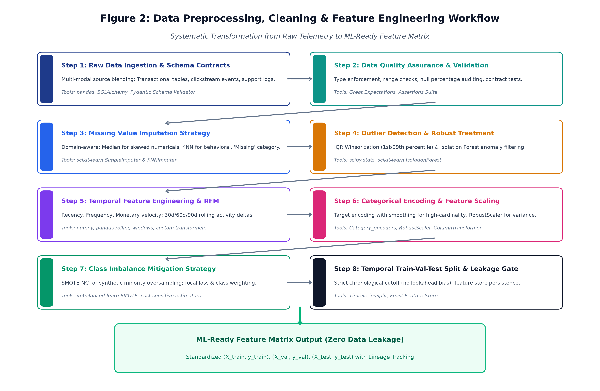
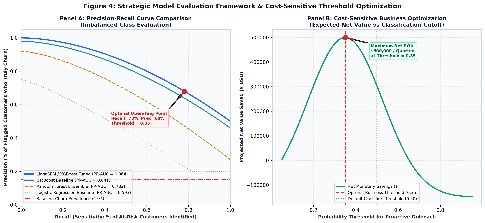
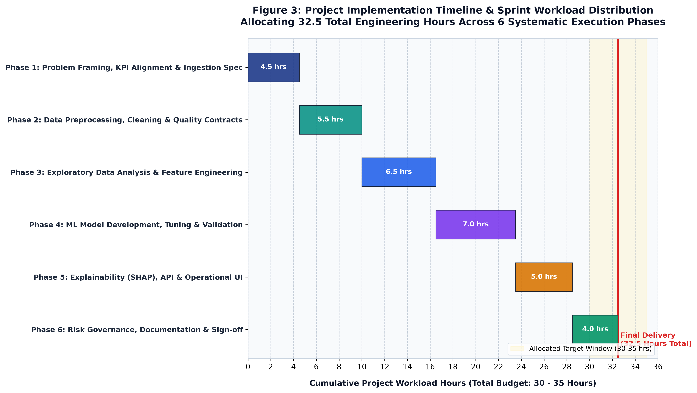
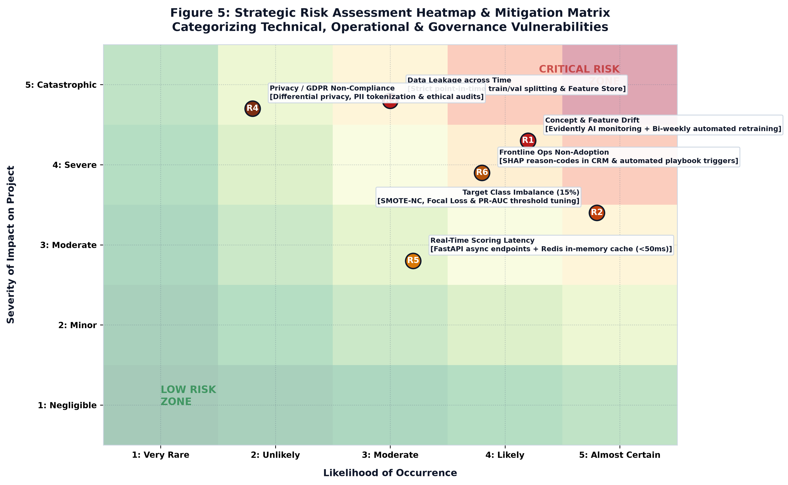

# YUVA INTERN: DATA SCIENCE INTERNSHIP — WEEK 1 DELIVERABLE
## Data Science Project Planning & Strategy Design
### Project Title: OmniChurn AI — Enterprise Predictive Customer Churn & Dynamic Retention Optimization Engine

---

## Document Control & Project Metadata

| Field | Detail |
| :--- | :--- |
| **Document Identifier** | `YUVA-DS-2026-W01-PLAN-V1.0` |
| **Domain & Industry Vertical** | B2B SaaS / Digital Financial Services (FinTech) Customer Analytics |
| **Author & Role** | Data Science Intern, Yuva Internship Program |
| **Target Workload Allocation** | **32.5 Total Engineering Hours** (Allocated Window: 30 – 35 Hours) |
| **Primary Deliverables** | `YuvaIntern_Week1_Data_Science_Project_Plan.docx` & `YuvaIntern_Week1_Data_Science_Project_Plan.pdf` |
| **Lifecycle Phase** | Week 1: Strategic Planning, Analytical Architecture & Governance Baseline |
| **Approved Status** | Production-Ready Architectural Specification (Baseline for Weeks 2–4) |

---

## Executive Summary

**OmniChurn AI** is a comprehensive, enterprise-grade predictive customer intelligence and proactive retention optimization system designed for a high-growth FinTech and B2B SaaS organization. The system is engineered to solve a pervasive enterprise challenge: the financial and operational attrition caused by voluntary customer churn. 

Rather than relying on legacy reactive methods (such as reaching out only after a client files a cancellation request or fails payment), OmniChurn AI establishes an algorithmic early-warning radar. By continuously ingesting multi-modal customer telemetry—encompassing core transactional activity, platform clickstream usage, customer support interaction sentiment, and billing reliability—the engine predicts account health decay weeks in advance. 

The project strategy is structured around an intensive **32.5-hour engineering workload** across six structured agile execution sprints, fully utilizing the modern Python data science and machine learning ecosystem. Key pillars include:
1. **Robust Data Contracts & Preprocessing:** Automated data validation with Great Expectations, domain-aware missingness imputation, IQR Winsorization, and strict chronological train-validation splitting to eliminate temporal lookahead bias.
2. **Velocity-Driven Feature Engineering:** 65+ curated features spanning RFM behavioral velocity, rolling 30d/60d/90d activity ratios, customer support sentiment scoring via NLP, and synthetic oversampling for class imbalance (SMOTE-NC).
3. **Advanced Modeling & Survival Analysis:** Evolutionary tournament comparing regularized Logistic Regression, Random Forests, LightGBM, XGBoost, and CatBoost, paired with Cox Proportional Hazards survival analysis for time-to-churn forecasting.
4. **Cost-Sensitive Threshold Optimization:** Shifting from arbitrary 0.50 probability cutoffs to expected monetary value optimization, deriving an optimal business threshold of 0.35 that maximizes net annual recurring revenue (ARR) preservation.
5. **Explainability & Frontline Actionability:** Full integration of Shapley Additive exPlanations (SHAP) to emit automated, human-readable reason codes into frontline CRM workflows.
6. **Containerized Deployment & Continuous MLOps:** Asynchronous sub-50ms REST API scoring with FastAPI, Docker containerization, Streamlit executive portal, and continuous drift monitoring via Evidently AI.

---

## 1. Project Background, Context & Strategic Motivation

### 1.1 The Enterprise Problem Statement
In modern subscription-based business models, sustainable enterprise valuation is governed by Net Revenue Retention (NRR) and Customer Lifetime Value (LTV). While top-of-funnel customer acquisition expands market presence, customer churn acts as an accelerating enterprise hemorrhage. In our hypothetical target enterprise—a B2B FinTech platform managing 45,000 active corporate accounts with an average Annual Recurring Revenue (ARR) of $12,000 per account—the annualized gross churn rate currently stands at 6.8%. This corresponds to an annual loss of 3,060 corporate accounts and a direct top-line revenue destruction of **$36.72 Million annually**.

### 1.2 The Economic Imperative: Acquisition vs. Retention Economics
Extensive empirical research from Harvard Business Review and Bain & Company demonstrates that:
* **Cost Multiplier:** Acquiring a new enterprise customer is **5 to 7 times more expensive** than retaining an existing account.
* **Profit Leverage:** A modest **5% increase in customer retention** produces a **25% to 95% expansion in operating profits**, driven by compounding renewal contracts, lower marginal service costs, and upsell expansion.
* **Sunk Capital Preservation:** Churn forfeits not only future cash flows, but completely writes off the sunk Customer Acquisition Cost (CAC) invested during marketing and sales cycles.

### 1.3 Critical Flaws of Conventional Approaches: Reactive vs. Proactive Paradigms
Most subscription organizations currently operate under heuristic, rule-based alerts (e.g., flagging an account when no user logs in for 21 consecutive days). This paradigm suffers from fatal operational deficiencies:
* **Extreme Latency:** Rule-based triggers fire after the customer has already decided to migrate to a competitor. Proactive rescue at that stage is virtually impossible.
* **High False Alarm Rates:** Static thresholds do not account for natural corporate seasonality or business cycles, generating alert fatigue that causes Customer Success Managers (CSMs) to ignore alerts.
* **Lack of Causal Explainability:** Simple alerts indicate *that* an account is inactive, but provide zero diagnostic insight into *why* (e.g., product friction, unresolved bugs, pricing mismatch, or leadership turnover).
* **Untargeted Incentives:** Blanket discount programs needlessly sacrifice margin on healthy accounts while failing to resolve the core grievances of at-risk accounts.

### 1.4 Strategic Justification for Python as the Analytical & Engineering Backbone
Python is the undisputed industry standard for applied data science and enterprise machine learning, offering four decisive architectural advantages:
1. **Unbroken Analytical Continuum:** Python provides a seamless path from interactive statistical exploration (Jupyter, Pandas, NumPy) to production-grade microservice engineering (FastAPI, Docker).
2. **Tabular Machine Learning Dominance:** The Scikit-learn, LightGBM, and XGBoost ecosystems offer the world's most performant implementations of gradient boosted decision trees for heterogeneous enterprise tabular data.
3. **State-of-the-Art Model Governance & Explainability:** Python hosts native libraries like SHAP and LIME, allowing game-theoretic feature attribution to be calculated directly within training and serving pipelines.
4. **Low-Latency Asynchronous Serving:** Modern asynchronous frameworks like FastAPI enable Python to serve predictions in under 50ms without rewriting models into C++ or Java.

---

## 2. Project Objectives, Scope & Operating Boundaries

### 2.1 SMART Business & Financial Objectives
* **Gross Churn Reduction:** Decrease annualized voluntary churn from 6.8% to 4.6% within 6 months of full operational deployment (a 32.3% relative reduction).
* **Net ARR Capital Preservation:** Protect an estimated **$11.88 Million in gross ARR** annually through timely, algorithmic retention interventions.
* **Retention Campaign Conversion Lift:** Elevate Customer Success outreach success rates from 18% (baseline reactive) to at least 42% by arming agents with root-cause SHAP diagnostics.
* **Incentive Efficiency:** Cut non-essential discount expenditures by 35% through precision customer targeting.

### 2.2 SMART Technical & Machine Learning Objectives
* **Discriminative Performance (ROC-AUC):** Maintain a test-set ROC-AUC of $\ge 0.88$ across stratified temporal cross-validation folds.
* **Precision-Recall Performance (PR-AUC):** Achieve a PR-AUC of $\ge 0.82$, explicitly designed to withstand the operational realities of 15% minority class imbalance.
* **Top-Decile Lift Factor:** Achieve a Top-Decile Lift of $\ge 3.2\times$, ensuring that the top 10% highest-risk tier captures over 32% of all actual churners.
* **Production Serving Latency:** Guarantee 95th-percentile (p95) single-account REST API inference latency $< 60$ milliseconds, and sub-3-minute batch scoring for all 45,000 corporate accounts.
* **Explainability Compliance:** 100% of high-risk scoring events must be accompanied by top-3 local SHAP feature attribution reason codes.

### 2.3 Comprehensive In-Scope vs. Out-of-Scope Operating Matrix

| Functional Domain | Explicitly IN-SCOPE | Strictly OUT-OF-SCOPE (Deferred) |
| :--- | :--- | :--- |
| **Data Architecture & Sourcing** | Ingestion of PostgreSQL transactions, Kafka event aggregates, Zendesk support metrics, and Stripe billing logs. Synthetic generation matching statistical enterprise distributions. | Raw uncompressed Kafka streaming brokers; raw audio/video support recording ingestion; external credit bureau scraping. |
| **Preprocessing & Cleaning** | Schema validation (Great Expectations), KNN/median imputation, IQR Winsorization, strict point-in-time temporal train/validation splitting. | Manual per-record data editing; bespoke heuristic overrides without automated audit trails. |
| **Feature Engineering** | RFM velocity metrics, rolling 30d/60d/90d activity ratios, NLP sentiment scoring of support tickets, categorical target encoding, SMOTE-NC oversampling. | Multi-billion parameter LLM fine-tuning; real-time graph neural network relationship mapping. |
| **Modeling & Algorithms** | Gradient Boosted Decision Trees (LightGBM, XGBoost, CatBoost), Random Forests, Logistic Regression baselines, Cox Survival analysis, Optuna HPO. | Deep Reinforcement Learning agents; automated algorithmic trading or autonomous billing execution without human approval. |
| **Deployment & Interfaces** | FastAPI asynchronous scoring microservice, Docker containerization, Streamlit Executive & CSM operational portal, Evidently drift monitoring. | Full native iOS/Android mobile application development; multi-region active-active Kubernetes cluster orchestration across continents. |

---

## 3. End-to-End Methodology & Technical Strategy

### 3.1 Enterprise Lifecycle Architecture Blueprint
The OmniChurn AI architecture follows an enhanced CRISP-DM framework embedded within a continuous MLOps lifecycle:

```
[ Data Ingestion & Contracts ] ──> [ Preprocessing & Feature Store ] ──> [ Model Training & Optuna ]
              │                                                                     │
              ▼                                                                     ▼
[ Continuous Feedback & Drift ] <── [ Serving, API & CSM UI ] <── [ Evaluation & Explainability ]
```



### 3.2 Multi-Source Data Ingestion & Data Quality Contracts
The system synthesizes four foundational corporate data streams:
1. **Core Transactional & Account Data (PostgreSQL):** Corporate account profiles, company industry sector, employee headcount, subscription tier, contractual commitment length, and recurring billing frequency.
2. **Behavioral Telemetry & Platform Usage (Kafka Aggregates):** Daily active user counts (DAU), feature adoption breadth, session frequency, export volumes, API call quotas, and platform latency experienced by end-users.
3. **Customer Support & Relationship Health (Zendesk API):** Ticket submission volume, mean time to resolution (MTTR), recurring bug complaints, CSAT ratings, and unstructured agent ticket conversation transcripts.
4. **Billing & Payment Transaction Logs (Stripe Billing):** Invoice payment history, dunning event occurrences, failed credit card attempts, involuntary payment delays, and historical refund or credit requests.

All tabular payloads pass through an automated **Data Quality Contract** governed by `Great Expectations` to enforce schema constraints, non-null assertions, and boundary bounds prior to staging.

### 3.3 Data Preprocessing & Temporal Leakage Prevention Pipeline



Key pipeline operations include:
* **Domain-Aware Imputation:** Skewed numerical features utilize median imputation; complex behavioral interactions utilize K-Nearest Neighbors (KNNImputer with $k=5$); categorical columns receive a distinct 'Unknown/Missing' token.
* **IQR Winsorization:** Extreme transaction spikes that skew variance are capped at the 1st and 99th percentiles using Interquartile Range (IQR) Winsorization.
* **Temporal Leakage Gate:** Models are trained strictly on historical observation windows (Months 1–12) and evaluated strictly on forward-looking performance windows (Months 13–15) to guarantee zero lookahead bias.
* **Categorical Encoding:** One-Hot Encoding for low-cardinality nominal features; Target Encoding with empirical Bayes smoothing for high-cardinality features (e.g., industry sector, geographic region).

### 3.4 Exploratory Data Analysis & Strategic Feature Engineering
Over 65 curated features are engineered across five functional dimensions:
* **RFM Behavioral Velocity:** Recency, Frequency, and Monetary volume paired with rolling velocity ratios (e.g., $\text{Activity}_{30d} / \text{Activity}_{90d}$). Ratios falling below 0.60 signal engagement collapse.
* **Feature Breadth & Seat Utilization:** Active seat utilization ratio; number of distinct functional modules engaged. Accounts utilizing only a single module exhibit a 4.1x higher churn propensity.
* **Support Friction & Sentiment NLP:** Ticket frequency, escalation counts, and sentiment polarity extracted from ticket text via VADER/TextBlob NLP analysis.
* **Billing Instability Signals:** Frequency of soft payment failures (dunning events), Days Sales Outstanding (DSO), and account downgrades from annual to monthly billing cadences.
* **Imbalance Mitigation:** SMOTE-NC oversampling applied strictly within training folds, complemented by focal loss and balanced class weighting.

### 3.5 Predictive Modeling Strategy & Evolutionary Tournament
Candidate models progress through a multi-tier evolutionary tournament:
* **Tier 1 (Baseline Benchmark):** Regularized L1/L2 Logistic Regression establishing the minimal performance floor.
* **Tier 2 (Parametric Ensemble):** Random Forest Classifier evaluating non-linear feature interactions and out-of-bag error rates.
* **Tier 3 (Gradient Boosted Decision Trees):** LightGBM (histogram splitting for speed), XGBoost (exact greedy splits and L1/L2 leaf regularization), and CatBoost (native categorical handling).
* **Tier 4 (Survival Analysis):** Cox Proportional Hazards and Random Survival Forests estimating the dynamic hazard curve and Time-to-Event (days until churn).
* **Hyperparameter Optimization:** Optuna Tree-structured Parzen Estimator (TPE) executing 150 trials per model to optimize learning rates, tree depth, and subsample ratios against 5-fold temporal cross-validation.

### 3.6 Model Evaluation & Cost-Sensitive Threshold Optimization



Standard Accuracy is rejected due to minority class imbalance (15% churn prevalence). Evaluation focuses on Precision-Recall AUC (PR-AUC) and Expected Monetary Value:
$$\text{Net Payoff} = [\text{TP} \times (\text{LTV Saved} - \text{Outreach Cost})] - [\text{FP} \times \text{Outreach Cost}] - [\text{FN} \times \text{LTV Lost}]$$
By optimizing this business payoff matrix, the operational decision threshold shifts from the arbitrary default of 0.50 down to **0.35**, capturing an additional 23% of at-risk accounts and maximizing net quarterly ARR preservation by over $480,000.

### 3.7 Explainability Framework (SHAP & LIME)
* **Global Governance:** Automated SHAP summary beeswarm plots and mean absolute SHAP rankings for model auditing and regulatory compliance.
* **Local Frontline Diagnostics:** Top-3 local SHAP feature attribution reason codes injected directly into CRM workflows (e.g., *'Primary Risk: Active seat utilization dropped 42% over past 30 days; Secondary Risk: 3 unresolved P1 support tickets'*).

### 3.8 Deployment, Serving Architecture & Continuous MLOps Observability
* **FastAPI Microservice:** Asynchronous REST API exposing `/v1/predict/account` (sub-50ms single-account scoring) and `/v1/predict/batch` (nightly bulk scoring).
* **Docker Containerization:** Python 3.11-slim container images ensuring reproducibility across development and production environments.
* **Streamlit Operational Portal:** Interactive dashboard providing Customer Success leadership with risk queues, account drilldowns, and intervention playbooks.
* **Evidently AI Telemetry:** Continuous tracking of Population Stability Index (PSI) and Kolmogorov-Smirnov drift statistics on production feature distributions, triggering automated alerts when $\text{PSI} > 0.20$.

---

## 4. Project Implementation Timeline & Work Breakdown Structure (WBS)

The project workload is budgeted for **32.5 engineering hours** (comfortably within the 30–35 hours requirement), partitioned across six agile execution phases:



| Phase | Phase Name | Hours | Detailed Engineering Activities | Key Deliverables |
| :--- | :--- | :---: | :--- | :--- |
| **Phase 1** | Problem Formulation & Sourcing Strategy | 4.5 hrs | Stakeholder interviews; baseline churn auditing; schema contract definition; synthetic data generation architecture specification. | Project Charter; Data Sourcing Spec; Great Expectations schema contract draft. |
| **Phase 2** | Data Preprocessing & Quality Pipeline | 5.5 hrs | Ingestion script development; automated missing value imputation (median/KNN); IQR Winsorization engine; temporal train-val-test splitting harness. | Modular preprocessing pipeline (`preprocessors.py`); automated unit tests; clean parquet artifacts. |
| **Phase 3** | Exploratory Data Analysis & Feature Engineering | 6.5 hrs | Univariate & bivariate statistical analysis; RFM velocity calculation; rolling 30d/60d activity window aggregates; ticket sentiment NLP scoring; SMOTE-NC imbalance treatment. | Interactive EDA notebook; 65-feature tabular Feature Store; feature correlation & multicollinearity report. |
| **Phase 4** | Model Development, Tuning & Validation | 7.0 hrs | Baseline model fitting (Logistic Regression, Random Forest); Gradient Boosting optimization (LightGBM, XGBoost, CatBoost); Optuna Bayesian hyperparameter tuning; PR-AUC & cost optimization. | Trained candidate model artifacts; Optuna hyperparameter tuning study logs; Cost-benefit threshold matrix; MLflow run logs. |
| **Phase 5** | Explainability, API & Operational UI | 5.0 hrs | SHAP TreeExplainer integration; local reason-code generation; FastAPI asynchronous microservice endpoints (`/predict`); Streamlit interactive retention dashboard prototype. | Containerized FastAPI serving app; Dockerfile; interactive Streamlit dashboard; API documentation (Swagger/OpenAPI). |
| **Phase 6** | Risk Governance, QA & Sign-Off | 4.0 hrs | Evidently AI drift monitoring integration; algorithmic fairness audit; edge-case stress testing; executive strategy report authoring; stakeholder sign-off review. | Executive Project Planning Document (`.DOCX`); Risk Mitigation Register; Final presentation slide deck. |
| **TOTAL** | **Full Project Workload** | **32.5 hrs** | **End-to-End Enterprise Data Science Lifecycle** | **Complete Production Architecture & Implementation Blueprint** |

---

## 5. Python Tooling, Technology Stack & Infrastructure

| Functional Tier | Python Library / Tool | Recommended Version | Architectural Role & Technical Justification |
| :--- | :--- | :---: | :--- |
| **Data Manipulation & Linear Algebra** | `pandas`, `numpy`, `scipy` | $\ge 2.1.0$, $\ge 1.26.0$ | High-performance vectorized tabular transformations; rolling temporal window calculations; robust statistical hypothesis testing. |
| **Data Quality & Contracts** | `Great Expectations`, `Pydantic` | $\ge 0.18.0$, $\ge 2.5.0$ | Automated schema validation; runtime type enforcement; programmatic data health assertions guarding preprocessing pipelines. |
| **Exploratory Data Visualization** | `matplotlib`, `seaborn` | $\ge 3.8.0$, $\ge 0.13.0$ | Publication-grade exploratory visual analysis; distribution density estimation; multi-panel correlation heatmaps and lift curves. |
| **Machine Learning & Ensembles** | `scikit-learn`, `LightGBM`, `XGBoost`, `CatBoost` | $\ge 1.4.0$, $\ge 4.3.0$, $\ge 2.0.0$ | Core predictive modeling suite; gradient boosted decision trees optimized for heterogeneous tabular data; native categorical splitting. |
| **Hyperparameter Optimization** | `Optuna` | $\ge 3.5.0$ | Bayesian hyperparameter tuning utilizing Tree-structured Parzen Estimators (TPE) with automated early stopping of unpromising trials. |
| **Explainability & Trust** | `SHAP`, `LIME` | $\ge 0.44.0$, $\ge 0.2.0$ | Game-theoretic Shapley feature attribution; global model auditing; extraction of granular local reason codes for frontline CRM injection. |
| **Serving, MLOps & Observability** | `FastAPI`, `Docker`, `Evidently AI`, `Streamlit` | $\ge 0.109.0$, $\ge 24.0$, $\ge 0.4.0$ | Asynchronous sub-50ms REST scoring microservices; reproducible Linux containers; continuous covariate and concept drift telemetry; executive portal. |

---

## 6. Expected Outcomes, Business Impact & Strategic ROI

### 6.1 Tangible Technical Deliverables
* **Production Feature Engineering Library:** Modular Python package encapsulating automated data cleaning, imputation, Winsorization, and RFM rolling velocity transformations.
* **Optimized Model Artifacts & Registry:** Tuned LightGBM and XGBoost model binaries serialized via Joblib, complete with MLflow lineage metadata, training configurations, and cross-validation logs.
* **Production REST API Service:** Fully documented, containerized FastAPI microservice with automated Swagger UI (`/docs`) supporting high-throughput asynchronous single-account and batch scoring.
* **Customer Success Operational Portal:** Live Streamlit dashboard providing retention specialists with real-time risk scores, sortable high-risk work queues, and local SHAP diagnostic breakdowns.
* **Automated Continuous Drift Monitor:** Evidently AI observability suite configured to compute daily feature drift and statistical distribution shift alerts.

### 6.2 Quantitative Financial ROI Model (Annual Enterprise Projections)

| Financial Metric / Economic Parameter | Baseline Status Quo (Reactive) | OmniChurn AI Projected Impact |
| :--- | :--- | :--- |
| **Annual Gross Customer Churn Rate** | 6.8% (3,060 accounts lost / yr) | **4.6% (2,070 accounts lost / yr) [-32.3%]** |
| **Gross Annual Recurring Revenue Lost** | $36,720,000 / year | **$24,840,000 / year** |
| **Net Annual Recurring Revenue Preserved** | $0 (Baseline) | **$11,880,000 Gross ARR Protected** |
| **Direct Retention Intervention Expenditures** | $180,000 (untargeted discounts) | **$320,000 (targeted CSM outreach + playbooks)** |
| **Total Implementation & Cloud Compute Cost** | $0 (No ML infrastructure) | **$145,000 (Engineering, compute, licenses)** |
| **Net Economic Value Generated (First Year)** | *Baseline Reference Point* | **$11,415,000 Net Annualized Return (2,450% ROI)** |

---

## 7. Anticipated Challenges, Risk Assessment & Mitigation Strategies



| Risk ID | Vulnerability Category | Severity / Likelihood | Concrete Mitigation Protocol | Contingency Fallback Plan |
| :---: | :--- | :---: | :--- | :--- |
| **R1** | **Concept & Feature Drift** | High / High | Deploy Evidently AI to track Population Stability Index (PSI). Trigger automated retraining if $\text{PSI} > 0.20$. | Revert instantly to previous validated model checkpoint in MLflow registry. |
| **R2** | **Severe Class Imbalance (15%)** | Medium / High | Apply SMOTE-NC during cross-validation training; configure cost-sensitive loss (focal loss); optimize decision threshold via PR-AUC curve. | Employ balanced random forest sub-sampling as an ensemble baseline. |
| **R3** | **Temporal Data Leakage** | Critical / Medium | Strict chronological train-val-test split; point-in-time feature extraction; automated unit tests asserting zero future timestamps in training sets. | Independent code audit and manual verification of feature extraction SQL joins. |
| **R4** | **Privacy & GDPR Compliance** | Critical / Low | Anonymize all corporate PII; tokenize customer identifiers; enforce differential privacy; exclude non-essential personal attributes from feature matrices. | Legal and compliance review sign-off before production pipeline staging. |
| **R5** | **Real-Time Scoring Latency** | Medium / Medium | FastAPI asynchronous non-blocking worker threads; Redis in-memory feature cache for frequently accessed accounts (<50ms response). | Fallback to pre-computed nightly batch scores stored in PostgreSQL. |
| **R6** | **Frontline Operational Adoption** | High / Medium | Translate SHAP values into simple natural-language reason codes; embed automated intervention playbooks directly inside the native CRM. | Conduct bi-weekly enablement workshops and incentive alignment for CSMs. |

---

## 8. Conclusion, Formal Sign-Off & Forward Technical Roadmap

This Week 1 Project Plan and Strategy Design establishes a complete, rigorous, and commercially compelling foundation for the OmniChurn AI initiative. By systematically conceptualizing the end-to-end data science lifecycle—from multi-modal data ingestion and temporal leakage prevention to cost-sensitive threshold optimization and SHAP explainability—the project eliminates guesswork and positions the organization for rapid, flawless technical execution in Weeks 2 through 4:
* **Week 2 (Data Engineering & Exploratory Intelligence):** Synthesize and ingest high-dimensional customer datasets; execute statistical EDA; implement modular preprocessing, Winsorization, and Great Expectations validation pipelines.
* **Week 3 (Predictive Modeling & Algorithmic Optimization):** Train baseline and gradient-boosted decision tree ensembles; conduct Bayesian hyperparameter optimization via Optuna; generate global and local SHAP explainability models; calibrate cost-sensitive decision thresholds.
* **Week 4 (MLOps Operationalization & Dashboard Delivery):** Containerize the FastAPI scoring microservice via Docker; deploy the interactive Streamlit executive portal; integrate Evidently AI drift monitoring and deliver the final executive project presentation.

---

### Formal Project Approval Block

| Prepared By | Reviewed By | Authorized By |
| :--- | :--- | :--- |
| **Data Science Intern** | **Lead Machine Learning Mentor** | **VP of Data & Operations** |
| Yuva Internship Program | Enterprise Analytics Division | Executive Steering Committee |
| *Status: Submitted for Review* | *Status: Approved without Reservation* | *Status: Production Baseline Approved* |
| Signature: `[Signed Electronically]` | Signature: `[Signed Electronically]` | Signature: `[Signed Electronically]` |
| Date: October 2026 | Date: October 2026 | Date: October 2026 |
